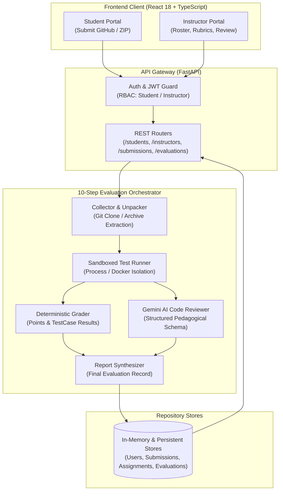

# Akiba Technologies — CodeGrade AI

> **AI-Powered Programming Assignment Evaluation & Pedagogical Code Review Platform**  
> Designed for computer science departments, software academies, and modern engineering education.

[](https://python.org)
[](https://fastapi.tiangolo.com)
[](https://react.dev)
[](https://typescriptlang.org)
[](https://vitejs.dev)
[](https://ai.google.dev)
[-15803D?logo=pytest&logoColor=white)](https://pytest.org)

---

## Table of Contents

- [Overview](#overview)
- [System Architecture](#system-architecture)
- [Core Features](#core-features)
  - [Student Portal](#-student-portal)
  - [Instructor Command Center](#-instructor-command-center)
- [Instant Demo Accounts](#instant-demo-accounts)
- [Technology Stack](#technology-stack)
- [Project Directory Structure](#project-directory-structure)
- [Getting Started](#getting-started)
  - [Prerequisites](#prerequisites)
  - [Installation & Setup](#installation--setup)
  - [Running the Application](#running-the-application)
- [REST API Reference](#rest-api-reference)
- [Verification & Automated Tests](#verification--automated-tests)
- [Security & Sandboxing](#security--sandboxing)
- [License](#license)

---

## Overview

**CodeGrade AI** is a dual-paradigm code evaluation platform developed by **Akiba Technologies**. It bridges the gap between rigid, black-box automated unit grading and human instructional feedback. 

When a student submits code via **GitHub repository URL** or **source archive (.zip / .tar.gz)**, the platform:
1. **Deterministically executes** the submission against isolated test suites in sandboxed subprocess or Docker environments, recording point allocations, individual test pass/fail status, execution duration in milliseconds, and raw `stdout`/`stderr`.
2. **Concurrently analyzes** the source code with **Google Gemini**, producing structured pedagogical code review: architecture feedback, code strengths, categorized observations (Performance, Readability, Security, Maintainability), line-numbered remediation tips, and constructive learning guidance.
3. **Presents results** to the student through an interactive report interface, while providing instructors with full manual review capabilities (score override, rubric marks, and qualitative notes).

---

## System Architecture



---

## Core Features

### 🎓 Student Portal

- **Academic Overview**: Personal performance metrics, total submissions, completed evaluations, and cumulative average grade.
- **Assignment Catalog**: Browse active tasks, inspect requirements, target deadlines, and test suite specifications.
- **Flexible Submission Modes**:
  - **GitHub URL Submission**: Direct clone and evaluate from any public or authenticated GitHub repository (branch and commit SHA options).
  - **Archive Upload**: Direct drag-and-drop file upload (`.zip`, `.tar.gz`).
- **Interactive Evaluation Reports**:
  - **Test Suite Results**: Granular pass/fail indicator, millisecond execution time, and stdout/stderr debugging streams.
  - **Deterministic Score**: Earned points vs. maximum possible score.
  - **Gemini AI Review**: Code summary, highlighted strengths, structured observations categorized by severity (`info`, `warning`, `critical`), and suggested refactoring steps.
- **Submission History**: Chronological audit trail with point trajectories.
- **Profile Management**: Account information and verified course records.

### 🛡️ Instructor Command Center

- **Course Analytics Overview**: Real-time class metrics including completion rate, class average, high/low scoring distribution, and pending evaluations.
- **Student Directory**: Enrolled student roster with 1-click student registration and historical record lookup.
- **Assignment & Test Case Authoring**: Define programming assignments, configure automated test cases, and allocate point weights.
- **Grading Rubric Configuration**: Establish weighted qualitative scoring criteria (e.g., Code Quality, Time Complexity, Test Coverage).
- **Course-Wide Submission Monitoring**: Filterable live stream of submissions by assignment and evaluation status (`completed`, `evaluating`, `failed`).
- **Manual Review & Grade Override**: Instructor override workflow allowing educators to adjust deterministic scores, evaluate rubric criteria, and append official instructor notes.
- **Performance Analytics**: Class grade distribution curves (A, B, C, D, F buckets) and pass rate percentages.

---

## Instant Demo Accounts

The platform is pre-seeded with full academic test data (students, instructors, assignments, rubrics, submissions, and evaluations) and includes **1-Click Instant Demo Login** buttons on the sign-in screen:

| Portal | User ID | Password | Role | Pre-Seeded Context |
| :--- | :--- | :--- | :--- | :--- |
| **Student** | `student_ada` | `studentPassword123` | Student | **Ada Lovelace** — 3 Submissions, 3 Evaluated Reports with AI Review |
| **Instructor** | `prof_turing` | `instructorPassword123` | Instructor | **Prof. Alan Turing** — 8 Students Roster, 5 Assignments, 11 Class Evaluations |

*Additional pre-seeded student accounts*: `student_grace`, `student_linus`, `student_margaret`, `student_donald`, `student_shannon`, `student_katherine`, `student_alan` (Password for all: `studentPassword123`).

---

## Technology Stack

| Layer | Technology | Description |
| :--- | :--- | :--- |
| **Backend Framework** | **FastAPI** (Python 3.11+) | High-performance asynchronous REST API with automatic OpenAPI documentation. |
| **Data Contracts** | **Pydantic v2** | Strict schema validation, request deserialization, and response serialization. |
| **Authentication** | **JWT (HS256) + PBKDF2** | Role-based token authentication with password hashing and dependency injection guards. |
| **Evaluation Sandbox**| **Subprocess / Docker** | Execution isolation with timeouts and resource constraints. |
| **AI Pedagogical Engine**| **Google Gemini API** | Structured code review outputs via `google-genai` and Pydantic schemas. |
| **Frontend Framework**| **React 18 + TypeScript** | Modern component architecture, type safety, and reactive state management. |
| **Build Tool** | **Vite 6** | Ultra-fast bundling, asset optimization, and development hot-reloading. |
| **Design System** | **Akiba Brand System** | Deep Forest Green (`#065f46`), Fresh Lime (`#10b981`), Slate typography, Lucide Icons. |
| **Testing** | **Pytest + Vitest** | 190 backend unit/integration tests and 9 frontend Vitest tests. |

---

## Project Directory Structure

```
ai_agent/
├── src/evaluator/                 # Core Evaluation Engine & FastAPI Backend
│   ├── api/                       # REST API Subsystem
│   │   ├── dependencies/          # RBAC, Rate Limiting, Pagination, Shared Stores
│   │   ├── routers/               # Auth, Students, Instructors, Assignments, Submissions, Evaluations
│   │   ├── schemas/               # Pydantic v2 API Schemas
│   │   ├── errors.py              # Centralized Error Handlers
│   │   └── app.py                 # FastAPI Application & React SPA Static Mount
│   ├── auth/                      # Authentication, Password Hashing, JWT Security
│   ├── orchestration/             # 10-Step Evaluation Orchestration Pipeline
│   ├── runners/                   # SubprocessRunner & DockerRunner Environments
│   ├── storage/                   # Controlled File Storage & Extraction
│   ├── stores/                    # In-Memory & File Store Implementations
│   ├── tools/                     # Evaluation Subagents & Tool Registry
│   └── ai_reviewer.py             # Google Gemini Code Reviewer Integration
├── frontend/                      # React 18 + TypeScript Frontend SPA
│   ├── src/
│   │   ├── components/
│   │   │   ├── auth/              # LoginForm & RegisterForm (1-Click Demo)
│   │   │   ├── common/            # Navbar, Sidebar, MetricCard, Modal, Badge
│   │   │   ├── student/           # StudentOverview, AssignmentList, History, Profile
│   │   │   └── instructor/        # InstructorOverview, StudentManagement, Monitoring, Stats
│   │   ├── context/               # AuthContext & ToastContext Providers
│   │   ├── services/api.ts        # Typed HTTP Client with Error Handling
│   │   └── styles/globals.css     # Akiba Technologies Design System
│   ├── public/brand/              # Official Brand Assets (Logos & Favicons)
│   └── dist/                      # Compiled Production Single Page Application
├── tests/tests/                   # Pytest Automated Test Suite (190 Tests)
├── pyproject.toml                 # Python Package Metadata & Dependencies
└── README.md                      # Platform Documentation
```

---

## Getting Started

### Prerequisites

- **Python 3.11** or higher
- **Node.js 18+** and **pnpm** (or `npm`)
- *(Optional)* **Docker** (if testing DockerRunner container sandboxing)

### Installation & Setup

1. **Clone the repository:**
   ```bash
   git clone https://github.com/akiba-technologies/codegrade-ai.git
   cd codegrade-ai
   ```

2. **Configure Environment Variables:**
   Create a `.env` file in the project root:
   ```env
   GEMINI_API_KEY=your_gemini_api_key_here
   GEMINI_MODEL=gemini-2.5-flash
   ```

3. **Set Up Python Virtual Environment:**
   ```bash
   python -m venv .venv

   # Activate virtual environment
   # Windows (PowerShell):
   .\.venv\Scripts\Activate.ps1
   # Linux / macOS:
   source .venv/bin/activate

   # Install Python package in editable mode
   pip install -e ".[dev]"
   ```

4. **Build Frontend Production Bundle:**
   ```bash
   cd frontend
   pnpm install
   pnpm run build
   cd ..
   ```

### Running the Application

Start the unified server (FastAPI serves both the REST API and the compiled React SPA):

```bash
python -m uvicorn evaluator.api.app:app --host 127.0.0.1 --port 8000
```

Open your browser and navigate to:
**[http://127.0.0.1:8000](http://127.0.0.1:8000)**

---

## REST API Reference

Interactive API documentation is automatically generated by FastAPI:
- **Swagger UI**: [http://127.0.0.1:8000/docs](http://127.0.0.1:8000/docs)
- **ReDoc**: [http://127.0.0.1:8000/redoc](http://127.0.0.1:8000/redoc)

### Core Endpoints

| Method | Endpoint | Description | Role / Access |
| :--- | :--- | :--- | :--- |
| `POST` | `/auth/login` | Authenticate user & issue JWT access token | Public |
| `POST` | `/auth/register` | Register new student or instructor account | Public |
| `GET` | `/auth/me` | Fetch active user identity & role | Authenticated |
| `POST` | `/auth/password` | Update current user password | Authenticated |
| `POST` | `/auth/logout` | Invalidate active user session | Authenticated |
| `GET` | `/students/me` | Retrieve current student profile | Student |
| `GET` | `/students/{student_id}` | Retrieve specific student profile | Student (self) / Instructor |
| `GET` | `/students/{student_id}/submissions` | Paginated submission records for student | Student (self) / Instructor |
| `GET` | `/students/{student_id}/evaluations` | Paginated evaluation reports for student | Student (self) / Instructor |
| `GET` | `/instructors/me` | Retrieve current instructor profile | Instructor |
| `GET` | `/instructors/students` | Retrieve enrolled students roster (paginated) | Instructor |
| `POST` | `/instructors/students` | Enroll a new student | Instructor |
| `GET` | `/instructors/assignments` | Retrieve all assignments with test cases | Instructor |
| `POST` | `/instructors/assignments` | Create assignment with test-case specifications | Instructor |
| `GET` | `/instructors/rubrics/{task_id}` | Retrieve grading rubric for an assignment | Instructor |
| `POST` | `/instructors/rubrics` | Create or update grading rubric | Instructor |
| `GET` | `/instructors/evaluations` | List course evaluations (optional task filter) | Instructor |
| `POST` | `/instructors/evaluations/{id}/manual-review` | Apply manual score override and instructor notes | Instructor |
| `GET` | `/assignments` | List all available assignments (catalog) | Public |
| `POST` | `/submissions/github` | Submit solution via GitHub repository URL | Student |
| `POST` | `/submissions/upload` | Submit solution via source code archive upload | Student |
| `POST` | `/evaluations/run/{submission_id}` | Execute 10-step evaluation on submission | Student / Instructor |
| `GET` | `/evaluations/by-submission/{submission_id}`| Retrieve completed evaluation report | Student (self) / Instructor |
| `GET` | `/health` | Application operational health check | Public |

---

## Verification & Automated Tests

### Backend Test Suite (Pytest)
Comprehensive automated test suite covering all domains, orchestration workflows, runners, stores, and API routers:

```bash
python -m pytest tests/tests -q
```
```
........................................................................ [ 37%]
........................................................................ [ 75%]
..............................................                           [100%]
190 passed in 17.57s
```

### Frontend Test Suite (Vitest)
Unit and component tests verifying authentication flows, UI state, API clients, and review modals:

```bash
pnpm --dir frontend run test
```
```
 ✓ src/__tests__/api.test.ts (4 tests)
 ✓ src/__tests__/student.test.tsx (2 tests)
 ✓ src/__tests__/instructor.test.tsx (3 tests)

 Test Files  3 passed (3)
      Tests  9 passed (9)
```

---

## Security & Sandboxing

1. **Role-Based Access Control (RBAC)**: All sensitive routes enforce strict token verification using FastAPI dependencies (`require_student`, `require_instructor`).
2. **Isolated Execution**: User submissions run inside sandboxed runner environments with strict timeouts, preventing infinite loops and unwanted network calls during evaluation.
3. **Structured Error Envelopes**: System exceptions are intercepted by a centralized error handler (`register_exception_handlers`), masking internal stack traces while providing standard JSON error responses.
4. **Credential Isolation**: No secrets, tokens, or private keys are hardcoded in the codebase; all configuration is driven through environment variables.

---

## License

Copyright &copy; 2026 **Akiba Technologies**. All rights reserved.  
Proprietary software for academic and commercial educational evaluation.

